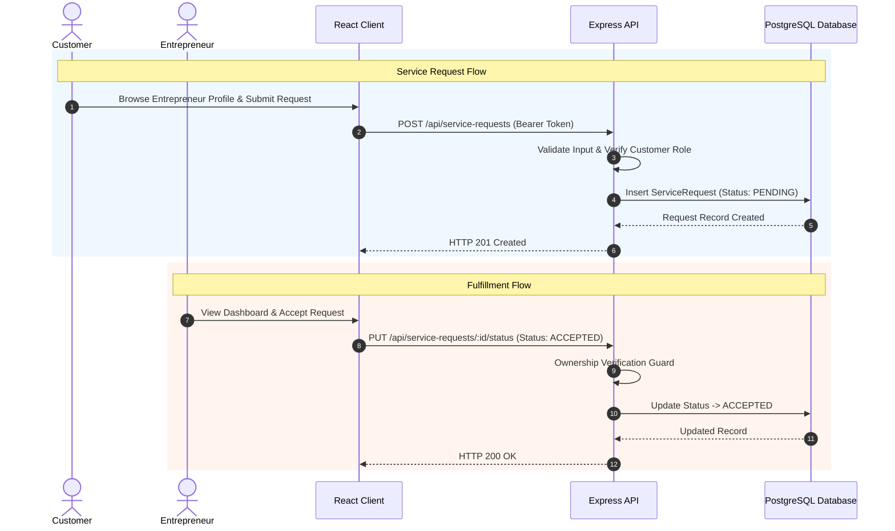

# HunarHub: Digital Marketplace for Local Micro-Entrepreneurs

## Executive Overview

HunarHub is an enterprise-grade full-stack digital marketplace designed to bridge the digital visibility gap for local micro-entrepreneurs—including cobblers, potters (*kumhars*), tailors, artisans, and small vendors. 

Many skilled micro-entrepreneurs operate exclusively via physical foot traffic or word-of-mouth recommendations, severely constraining their income growth, financial resilience, and market reach. HunarHub provides a centralized, accessible web platform enabling micro-entrepreneurs to showcase their skills, maintain transparent service listings and product catalogs, accept booking requests, and fulfill customer orders directly without intermediary exploitation.

### Expected Impact & Scaling Strategy

HunarHub is structured to drive scalable socio-economic benefits as platform adoption expands:

- **Increased Income for Local Micro-Entrepreneurs**: Disintermediates local commerce, allowing vendors to retain full earnings from product catalog sales and service bookings (`ServiceRequest`).
- **Preservation & Promotion of Traditional Skills**: Highlights specialized craft categories (*Potters/Kumhars*, *Cobblers*, *Tailors*, *Artisans*) and detailed profiles to preserve cultural heritage against mass-market competition.
- **Stronger Local Economies**: Circulates financial capital locally by connecting neighborhood consumers directly with local service providers and small vendors.
- **Digital Inclusion of Small Vendors**: Features a minimal, accessible Bootstrap-driven interface, simple registration flows, and admin onboarding support to lower digital barriers for vendors of all technical literacy levels.

---

## Architectural Principles & Ethical Design Standards

The platform has been engineered adhering to industry-standard software engineering paradigms, ethical design principles, and strict security patterns:

1. **Security-First Architecture (Defense in Depth)**
   - **Access Control**: Strict Role-Based Access Control (RBAC) enforcing explicit scope boundaries across `CUSTOMER`, `ENTREPRENEUR`, and `ADMIN` roles.
   - **Request Validation**: Zero-trust input sanitization preventing injection, format anomalies, and out-of-bounds parameters prior to database interaction.
   - **Cryptographic Hygiene**: Passwords hashed using Bcrypt (cost factor 12). Authentication endpoints utilize constant-time comparison patterns to resist user enumeration via timing analysis.
   - **Network Security**: HTTP security headers managed via `Helmet`, strict CORS origin restrictions, and request body size caps (10 KB) to defend against Denial of Service (DoS) vectors.
   - **Rate Limiting**: Distributed rate limiters applied globally and specifically to authentication endpoints to prevent brute-force attacks.

2. **Ethical & Inclusive Design**
   - **Direct Economic Empowerment**: Disintermediates local commerce, ensuring 100% of agreed revenues remain with the micro-entrepreneur.
   - **Low-Barrier Accessibility**: Designed with a simple, high-contrast, responsive user interface optimized for varying levels of digital literacy and basic internet connectivity.
   - **Data Privacy & Minimization**: Collects only essential transactional parameters; suppressing verbose internal error traces to prevent schema disclosure.

3. **Domain Separation & Maintainability**
   - Decoupled client-server architecture utilizing explicit REST API contracts.
   - Single Responsibility Principle (SRP) maintained across routes, controllers, middleware validators, and data access layers.

---

## System Architecture & Data Flow Diagrams

### High-Level Architecture Flow

```
[ Web Browser Client ]
         │
         │ HTTPS / JSON REST APIs
         ▼
[ Express.js API Gateway ]
   ├── Helmet & CORS Middleware
   ├── Express-Rate-Limit (Auth & Global)
   ├── JWT Authentication Guard
   └── Input Sanitization & Validation Layer
         │
         ├── Auth Controller ────────► Bcrypt Hashing
         ├── Entrepreneur Controller
         ├── Product Controller
         ├── Order Controller
         ├── Service Request Controller
         └── Admin Controller
         │
         ▼
[ Prisma ORM Layer ]
         │
         ▼
[ Supabase PostgreSQL Database ]
```

### End-to-End User Interaction Flow



---

## Technical Stack

| Layer | Component | Description / Specification |
| :--- | :--- | :--- |
| **Frontend** | Framework | React 18 (Single Page Application) |
| | Routing | React Router v6 |
| | HTTP Client | Axios with Request Interceptors for JWT propagation |
| | UI Library | Bootstrap 5 with custom responsive layout extensions |
| **Backend** | Runtime | Node.js |
| | Web Framework | Express.js |
| | ORM | Prisma ORM 5 |
| | Authentication | JSON Web Tokens (JWT) & Bcrypt.js |
| | Security | Helmet, Express-Rate-Limit, CORS |
| **Database** | RDBMS | PostgreSQL (Hosted on Supabase) |
| | Migration Strategy | Prisma Migrations & Declarative SQL Scripts |

---

## Repository Structure

```
hunarhub/
├── docs/
│   └── PRD_AND_TECHNICAL_DOCUMENTATION.md    # Product requirements & full technical documentation
├── client/                                    # Frontend React Application
│   ├── public/                                # Static assets and HTML template
│   ├── src/
│   │   ├── api/
│   │   │   └── client.js                      # Axios instance configured with auth headers
│   │   ├── components/
│   │   │   ├── Navbar.js                      # Dynamic, role-aware navigation bar
│   │   │   └── ProtectedRoute.js              # Route guard for role authorization
│   │   ├── context/
│   │   │   └── AuthContext.js                 # Global authentication and session state
│   │   ├── pages/
│   │   │   ├── AdminDashboard.js              # Verification, categories, analytics & monitoring
│   │   │   ├── CustomerDashboard.js           # Order tracking, request history & review submission
│   │   │   ├── EntrepreneurDashboard.js       # Profile management, product CRUD & fulfillment
│   │   │   ├── EntrepreneurList.js            # Directory search & multi-criteria filters
│   │   │   ├── EntrepreneurProfile.js         # Public profile, product gallery & booking modal
│   │   │   ├── Home.js                        # Hero banner, feature highlights & category pills
│   │   │   ├── Login.js                       # User authentication view
│   │   │   ├── ProductList.js                 # Marketplace catalog view
│   │   │   └── Register.js                    # Account creation view
│   │   ├── index.css                          # Stylesheet containing tab button definitions
│   │   ├── index.js                           # Client entry point
│   │   └── App.js                             # Client route definitions
│   ├── .env.example                           # Frontend environment template
│   └── package.json
└── server/                                    # Backend Express REST API
    ├── prisma/
    │   ├── schema.prisma                      # Data model definitions & relations
    │   ├── migrations.sql                     # Idempotent raw SQL migration & seed script
    │   └── seed.js                            # Seed script for categories and default admin
    ├── src/
    │   ├── controllers/                       # Business logic per module
    │   │   ├── adminController.js
    │   │   ├── authController.js
    │   │   ├── categoryController.js
    │   │   ├── entrepreneurController.js
    │   │   ├── orderController.js
    │   │   ├── productController.js
    │   │   ├── reviewController.js
    │   │   └── serviceRequestController.js
    │   ├── middleware/
    │   │   ├── auth.js                        # JWT verification & role enforcement
    │   │   └── validators.js                  # Request validation & input sanitization
    │   ├── routes/                            # Modular REST endpoint routing
    │   │   ├── admin.js
    │   │   ├── auth.js
    │   │   ├── categories.js
    │   │   ├── entrepreneurs.js
    │   │   ├── orders.js
    │   │   ├── products.js
    │   │   ├── reviews.js
    │   │   └── serviceRequests.js
    │   ├── utils/
    │   │   └── prismaClient.js                # Singleton Prisma client instance
    │   └── server.js                          # Express application initialization & middleware
    ├── test/
    │   └── security_and_validation.test.js    # Security & validation test suite
    ├── .env.example                           # Backend environment template
    └── package.json
```

---

## Database Model & Data Integrity

The system enforces relational integrity across 7 core entities:

```
[ User ] (1) ──── (0..1) [ Entrepreneur ] (1) ──── (0..N) [ Product ]
   │                            │                              │
   │ (1..N)                     │ (1..N)                       │ (1..N)
   ▼                            ▼                              ▼
[ ServiceRequest ]        [ Review ]                       [ Order ]
```

### Core Constraints
- **Unique Constraints**: User emails are case-insensitively unique. Categories are unique. Each Order or Service Request can receive at most one Review via unique foreign key bindings (`orderId`, `serviceRequestId`).
- **Cascade Rules**: Deleting an `Entrepreneur` safely cascades to associated `Product` listings while preserving transactional auditing records in `Order` and `ServiceRequest`.
- **Validation Controls**: Review ratings bounded between 1 and 5 (`CHECK (rating BETWEEN 1 AND 5)`).

---

## Installation & Configuration Guide

### Prerequisites
- Node.js (v18.x or higher)
- npm (v9.x or higher)
- Active PostgreSQL database instance (or Supabase project)

---

### Step 1: Backend Setup

1. Navigate to the server directory:
   ```bash
   cd server
   ```

2. Copy the environment configuration template:
   ```bash
   cp .env.example .env
   ```

3. Populate `.env` with your environment variables:
   ```env
   PORT=5000
   DATABASE_URL="postgresql://postgres:[PASSWORD]@[HOST]:6543/postgres?pgbouncer=true"
   DIRECT_URL="postgresql://postgres:[PASSWORD]@[HOST]:5432/postgres"
   JWT_SECRET="your-secure-random-jwt-secret-key"
   CLIENT_URL="http://localhost:3000"
   ```

4. Install server dependencies:
   ```bash
   npm install
   ```

5. Execute database migrations and seed default data:
   ```bash
   # Generate Prisma Client
   npm run prisma:generate

   # Apply migrations
   npm run prisma:migrate

   # Seed default categories and initial admin account
   npm run prisma:seed
   ```

   *Alternatively, run `server/prisma/migrations.sql` directly inside the Supabase SQL Editor.*

6. Start the API server in development mode:
   ```bash
   npm run dev
   # API running on http://localhost:5000/api
   ```

---

### Step 2: Frontend Setup

1. Navigate to the client directory:
   ```bash
   cd ../client
   ```

2. Copy the environment configuration template:
   ```bash
   cp .env.example .env
   ```

3. Verify environment settings in `.env`:
   ```env
   REACT_APP_API_URL=http://localhost:5000/api
   ```

4. Install client dependencies:
   ```bash
   npm install
   ```

5. Launch the client application:
   ```bash
   npm start
   # Application running on http://localhost:3000
   ```

---

## Quality Assurance & Automated Testing

The codebase includes an automated unit and security test suite covering input validators, role guards, JWT token headers, and UUID formats.

Run the backend test suite:
```bash
cd server
npm test
```

### Test Suite Execution Output
```text
==========================================
 Running Security & Validation Test Suite
==========================================
✓ isValidUUID correctly identifies valid and invalid UUIDs
✓ validateRegister enforces name, email, password strength, and entrepreneur category
✓ validateLogin enforces email format and non-empty password
✓ validateProduct requires non-empty name and positive price
✓ validateOrder enforces valid UUID productId and positive integer quantity
✓ validateReview enforces valid UUID entrepreneurId and rating between 1 and 5
✓ validateServiceRequest enforces valid UUID entrepreneurId and description length
✓ requireAuth rejects missing or malformed headers
✓ requireRole enforces role authorization
==========================================
 Results: 9 passed, 0 failed
==========================================
```

---

## Default Administrative Credentials

Upon running `npm run prisma:seed`, the system automatically provisions an administrative user for platform governance:

- **Email**: `admin@hunarhub.com`
- **Password**: `AdminPassword123!`
- **Role**: `ADMIN`

*Note: In production environments, immediately rotate administrative credentials via database SQL execution.*

---

## License & Maintenance

This software is released under the MIT License. Maintained in accordance with ethical software engineering practices to ensure reliability, security, and digital inclusion for local micro-entrepreneurs.
